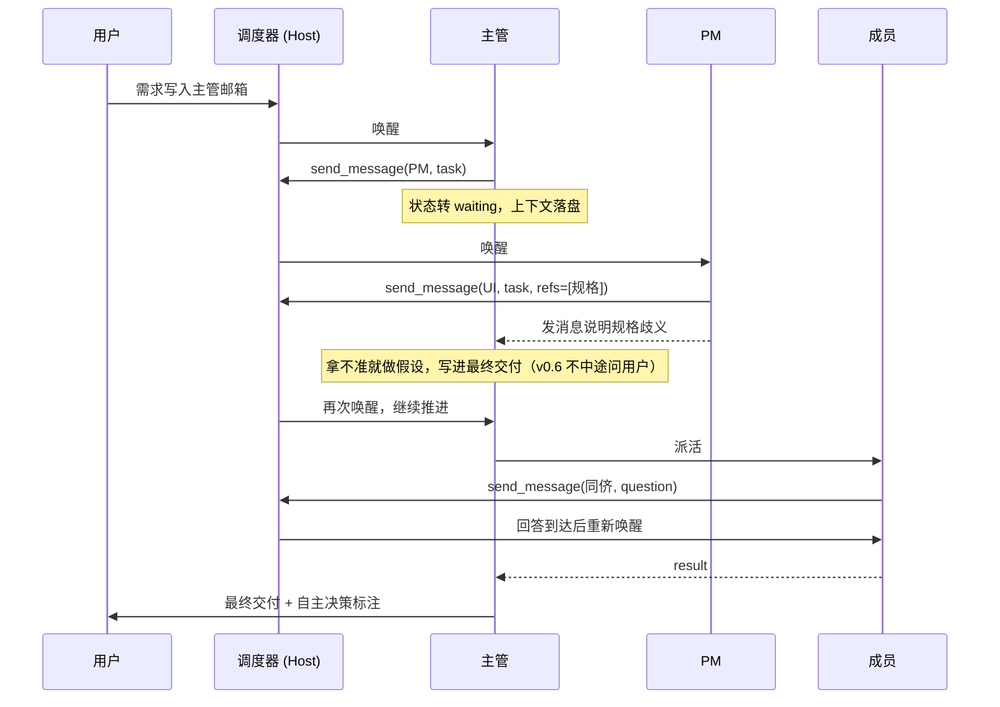

# Team agent：组织式多 agent 运行时

> 状态：草案，未实现。本文件先定义产品规则、所有权边界与交互面，实现前不写代码。

## 背景与一句话定义

现有的多 agent 是**调用式**：主会话派生一个子 agent，子 agent 交回结果即结束，子 agent 之间无法直接通信。

本需求要的是**组织式**：用户配置一个主管，主管按业务需要招人，成员有持久身份、分工明确，任意两个成员之间都能直接发消息，整个交付流程自动跑完，只在真正不确定时才回到用户面前。

## Product rules

- 团队属于 **workspace**，不属于 session。同一 workspace 的多个窗口共享同一批 agent；切换 workspace 即切换团队。团队配置、运行库与成员记忆属于本机运行数据，写在 ZCode 用户数据目录，不写进用户项目。
- **agent 是身份，任务才是会结束的东西。** agent 状态只有 `idle / running / waiting / archived`，没有 `done`。交付完活的成员仍然可以被同事提问。
- **成员 id 是唯一身份，名字只用于展示。** 发消息、任务归属、等待租约、记忆文件都按 `team_member.id` 读写；名字可以改、可以重名清洗后冲突，但不参与任何寻址。模型在名册里看到「名字（id）」，发消息时收件人写 id。
- 交付链路固定为：用户 → 主管 → PM → UI → 组长 → 成员，成员之间并行；任何成员都可以跨层向任何人发消息提问，但**升级路径唯一**。
- **团队交付期间不向用户提问。** v0.6 起 `ask_user` 不暴露给任何团队成员；主管拿不准时做合理假设，并在最终交付里显式标注哪些决定是替用户做的。其他角色卡住时只能发消息给上级，由上级决定是否调整范围或换做法。
- 下游对上游产出有**一次退回权**。任务被打回后 `revision` 记 1，再次退回必须升级给主管，不允许无限互退。
- 自主决策不阻塞其他分支；最终交付必须逐条列出替用户做的决定和未验证的部分。
- UI 环节的产出是**可运行的 HTML 原型**，不是图片。这样测试环节能做确定性验收，而不是依赖模型自评。
- 用户只有四个交互面：配置团队、提需求、看进展、打断插话。v0.6 不提供团队中途提问；不新增第五个。

## Ownership and boundaries

**团队定义**按 workspace 归属，但存储在 ZCode 用户数据目录（按工作区身份分目录，见「激活方式」）。创建入口只有团队面板；高级用户可以直接编辑那份配置，但它不会出现在项目仓库里，也不参与代码 review。

**运行时状态**（成员、消息、任务、租约、transcript）归 Local Host 所有。这是唯一所有者：调度循环、消息投递、租约超时都在 Host 侧，UI 只读投影。Main 和 relay 不保存团队状态。

**展示层复用现有 workflow 组件**，不新建第二套：`WorkflowRunSidePane`（阶段与状态）、`WorkflowTimeline`（时序）、`workflow-graph`（拓扑）、`WorkflowActorSessionSidePane`（单个成员的 transcript）、`pendingQuestions`（提问与回答）。现有 `workflow-graph/types.ts` 已为运行时数据源预留了 `statuses` 入口，本需求是给它提供真实数据，而不是另画一套图。

**通信**沿用 `Agent` 工具与 `dynamic-workflows` 的消息语义：Host 侧只做路由与状态，不解释消息内容。

**状态机只允许一个写入者**：`idle → running → idle|waiting → running`，全部由调度循环推进。工具只写消息表，绝不直接改 agent 状态——否则会出现 `runtime → tool → scheduler → runtime` 的循环依赖，调度逻辑会碎在几十个调用点上。



## Interaction surfaces

| 时刻                  | 落点                                                               | 与现状的差异                                                       |
| --------------------- | ------------------------------------------------------------------ | ------------------------------------------------------------------ |
| 配置团队              | 新建：团队面板（配置写入用户数据目录）+ `/team` 命令               | 无现成对应。subagent markdown 是单 agent 定义，不含层级与预算      |
| 提需求                | 现有 Composer                                                      | 消息进主管邮箱，不进主 agent；会话标题改为需求摘要                 |
| 看进展                | 现有 `WorkflowRunSidePane` / `WorkflowTimeline` / `workflow-graph` | 图的分组从 phase 改为**汇报关系**；成员卡点开是该成员的 transcript |
| 被提问（v0.6 不启用） | 现有 `pendingQuestions` + `qid`                                    | 团队交付期间不向用户提问；主管做假设并在最终交付里列出             |
| 打断插话              | 现有 `CommandInbox` 串行 admission + Cancel / Resume               | 复用。插话进主管邮箱，不打断正在跑的成员                           |

团队视图挂 workspace，**不新增一级入口**。侧栏仍是任务列表，点进任务看这次交付，点 workspace 看组织。

### 团队配置的编辑形态

**配置属于本机运行数据，不进用户项目。**

团队配置写成 ZCode 用户数据目录下的一个 JSON 文件，由团队面板创建；高级用户可以直接编辑它，但项目仓库里看不到它，也不会被误提交。界面负责创建和展示，不把 prompt 文本藏进表单——成员人设由岗位与职责生成，不在配置里存整段 prompt。

理由：团队配置是“这台机器上这个项目要不要有团队”的开关，不是项目源码；把它放进仓库会泄露需求正文、成员对话与记忆，也会在同步盘上引入 SQLite 锁风险。代价是换机器或复制项目不会带走团队，这一版接受。

### 完整交互流程

| 阶段                  | 用户看到                                             | 用户能做                                |
| --------------------- | ---------------------------------------------------- | --------------------------------------- |
| 未配置                | Composer 工具条团队按钮显示「＋ 配置团队」，弱化样式 | 点击打开团队面板创建团队                |
| 已配置、未选          | 按钮显示团队名与人数，默认仍是单人模式               | 点开选择团队，或直接发送走单人          |
| 已选、未发送          | Composer 下方出现一行提示：本任务将由某团队承接      | 取消选择，回到单人                      |
| 运行中                | 右侧栏出现组织视图，成员状态实时变化                 | 点成员看它的 transcript；可插话，不打断 |
| 待回答（v0.6 不启用） | 不出现提问卡；主管把假设写进最终交付                 | 无需回答，直接看交付里的决策清单        |
| 已完成                | 交付卡片 + 「我替你做的决定」一节                    | 查看改动、重新发起、复制结论            |

### 反馈约定

- 组织视图里每个成员只有四种可见状态：待命、执行中、等待他人、已交付。**不加第五种**，状态越多越难扫读。
- 主管的每一次招人都要在对话区留一行细体记录（谁招了谁、为什么），不进团队视图的卡片里。团队视图只表达"现在谁在干什么"。
- 提问卡（v0.6 不启用）**不进模态**，不抢焦点。用户正在打字时它静默排队。
- 交付完成时，凡是在用户缺席期间由主管自主决定的事项，必须在交付卡片末尾单独列出，不能只写在正文里。

## Tools exposed to agents

| 工具                                                     | 谁能用                       | 语义                                                              |
| -------------------------------------------------------- | ---------------------------- | ----------------------------------------------------------------- |
| `create_agent(role, persona)`                            | 主管 / PM / 组长             | 受 `depth`、`children_limit`、`tokens_limit` 三重约束             |
| `send_message(toMemberId, kind, content, refs?, await?)` | 所有 agent                   | 收件人写成员 id，不写名字；`kind` 决定语义；`refs` 传引用而非复述 |
| `ask_user(question, context)`                            | **不暴露给团队成员（v0.6）** | 交付期间没有人在看会话；主管做假设并在最终交付里列出              |
| `finish(summary, refs)`                                  | 所有 agent                   | 结束自己的 task，人仍留在 `idle`                                  |

消息必须能挂引用（文件路径、task id、上一条消息 id、artifact）。只传自然语言会让下游丢失上下文，这是这类系统最常见的失效点。

## Permissions

- 成员执行工具走与主 agent **完全相同**的权限判定，不新建旁路。每个成员的判定发生在它自己那一轮里，调度器不参与——调度器不解释业务，也不解释权限。
- 授权粒度是**团队级**，不是成员级。团队文件声明这支团队可能触及的能力边界（可写目录、可执行命令族、网络、可调模型），用户启动团队时一次性确认。成员在边界内自由行动，越界时走现有 `PermissionDialog`。
- **主管不能代成员授权。** 主管能做的是把越界请求转成 `escalate`，由用户直接面对提出请求的那个成员。代授权会让主管变成一个权限放大器，一次误判就波及整支团队。
- 成员被 `archived` 后其授权立即失效，历史 transcript 中的工具调用不作为后续授权的依据。
- 并行成员同时请求同类权限时合并为一次弹窗，展示成员列表与请求内容，而不是 N 次相同提问。

## Failure and degradation

| 情况               | 处理                                                                                                                                                                                                                                                                                                                                |
| ------------------ | ----------------------------------------------------------------------------------------------------------------------------------------------------------------------------------------------------------------------------------------------------------------------------------------------------------------------------------- |
| 选人顺序           | 按每个成员**最早一条未读消息**的时间排序；同一时间再按入职时间与 rowid 兜底。不能按成员入职时间排序——主管/产品经理入职最早，只要它们持续有未读消息，后入职的干活成员会永远排不到                                                                                                                                                    |
| 等待超时           | watchdog 扫过期租约，投一条 `kind=system` 消息给等待者，由它决定重试或升级。**超时是消息，不是异常分支**                                                                                                                                                                                                                            |
| 等待中对方仍在执行 | **不判超时**。租约顺延到对方这一轮必然结束的时刻（该轮 `started_at + 单轮上限`）。对方这一轮结束时若仍未回复，租约立即到期——由 `finishTurn` 把 deadline 拨到现在。判据是「对方这一轮结束了没有」，不是墙钟                                                                                                                          |
| 长时间没有任何输出 | **看门狗判卡住，不是按时长判**。判据是这一轮多久没有可观测输出（模型请求 / 流式吐字 / 工具开跑与出结果 / 压缩），不是跑了多久——一直在写文件的人可以跑很久。判定后中止这一轮、置 `failed`、投 `[卡住]` 给上级；不自动重试（同一轮再跑一次只会再卡一次），要恢复必须由上级重新派活。同时清算等它的租约，避免同一件事再说一遍 `[超时]` |
| 交付达到时间上限   | **软停，不是全掐**。停止派新活，给在跑的轮次一个收尾窗口（上限等于单轮上限）；窗口内收尾的轮次正常交还，只有仍未结束的才被中止。仅在配置了上限时生效，`maxDurationMs: 0` 表示不限                                                                                                                                                   |
| 被系统中止的一轮   | 系统消息写作 `[暂停]` 而不是 `[失败]`，明确「不是你做错了，已产出的还在」。写成失败会让成员下一轮从零重做，实测两轮 29 分钟零产出                                                                                                                                                                                                   |
| 清空租约           | 同时把 `waiting` 复位为 `idle`。只删表会让成员永久不可跑（`readyMembers` 只选 `idle`），而 `hasWaiting()` 已为 false，下一次发起在停滞阈值内直接退出                                                                                                                                                                                |
| 同侪踢皮球         | 问答链带 `chain_id` 与深度，超过上限强制 escalate 给上级                                                                                                                                                                                                                                                                            |
| 下游退回           | `revision >= 1` 后再退，直接拒绝并转升级                                                                                                                                                                                                                                                                                            |
| 用户长时间不在     | 主管超时自主决策，交付里标注「此处由我代为决定」                                                                                                                                                                                                                                                                                    |
| 预算耗尽           | 停止招人，已招成员跑完，主管在交付里说明未覆盖的范围                                                                                                                                                                                                                                                                                |
| 进程重启           | 全部状态在库中，调度器重新扫描并续跑；未消费消息不重复执行                                                                                                                                                                                                                                                                          |

## Acceptance and validation

1. 同一 workspace 重开窗口，团队仍在；切换 workspace 后是另一批 agent，id 不串。
2. 中途 kill 进程再启动，未完成任务继续跑完，已交付任务不重复执行。
3. 主管未完成的等待在重启后仍处于 `waiting`，且租约被正确重建。
4. 下游退回同一环节两次，第二次被拒绝并升级给主管。
5. 问答链超过深度上限时强制 escalate，不再继续追问。
6. 用户不在超过阈值后，主管自主决策且最终交付包含显式标注。
7. 团队成员无法调用 `ask_user`：工具不注册，模型只能发消息或把假设写进结果。
8. 桌面 `desktop-continuous` 与手机 `web-remote-replayable` 两条链路都能还原同一段团队消息流。
9. `pnpm typecheck`、`pnpm lint`、`pnpm architecture:check --changed` 通过；未执行的平台或模型路径如实标注。
10. 等待方不会因为对方单轮未结束就收到假超时；对方轮次结束时若确未回复，超时在同一轮内送达。
11. 交付达到时间上限时，在跑的轮次有收尾窗口，成员收到的是 `[暂停]` 而非 `[失败]`。
12. `clearWaits()` 之后不存在 `waiting` 残留，这些成员能被下一次发起重新调度。
13. `maxDurationMs: 0` 时不会因为「已运行 0 毫秒」立即判定超时；单轮上限按 `turnTimeoutMs` 生效。
14. 一轮长时间没有输出被判卡住：该成员置 `failed`、上级收到 `[卡住]`，且不会被自动重排；上级重新派活后恢复可跑。
15. 一直在输出（流式吐字 / 工具调用）的轮次即使总时长超过看门狗阈值也不被判卡住。
16. 主管和产品经理持续有未读消息时，后入职的干活成员仍能在前两人结束一轮后获得执行机会；选人按最早未读消息时间排序，而不是按成员入职时间排序。
17. 成员 id 是唯一寻址键：`MessageTeammate` 只接受名册里的 id，传名字返回业务失败并列出可用「名字（id）」；任务归属、等待租约与记忆文件都按 id 落库/落盘。
18. 两个名字清洗后相同（如 `a b` 与 `a_b`）的成员不会共用记忆文件；旧版按名字命名的记忆在库第一次打开时迁移到 id 文件，迁移失败保留原件、下次重试。

## Open questions

- 组织树在多窗口之间是否需要实时同步，还是各窗口独立拉取投影。
- 团队文件被外部编辑（用户手改）时，运行中的团队是按新文件重建，还是下一轮生效。
- 成员被 `archived` 后，其历史 transcript 是否还对新任务可见。

## ZCode 落地（v0.1 已实现）

### 激活方式

- **用户数据目录里的 `team.json` 是唯一开关**。文件不存在时：团队工具不会真正接活、SQLite 一个都不建，老用户感觉不到任何变化。
- 主会话只多一个 `StartTeam`；团队成员会话才有 `CreateTeammate` / `MessageTeammate` / `SubmitTask` / `SaveMemory` / `DeliverResult`。身份由 `member(sessionId)` 决定，模型无法伪造。
- 团队按 workspace 归属，但存储在本机用户数据目录：`<cliStorageRoot>/teams/<slug>-<hash>/` 下分别是 `team.json`、`team.db` 与 `memory/<成员id>.md`。目录名里的 hash 取 `workspaceIdentity?.trim() || 规范化后的工作区路径`（Windows 转小写），桌面端用 `<应用数据根>/.zcode/cli` 作为存储根，保证两边算到同一目录。切 workspace 等于换团队，项目仓库里不会出现团队文件。
- **旧数据一次性迁移**：agent 启动时若发现项目里还有旧版 `.zcode/team.json`，会把配置、数据库（含 WAL/shm）与记忆复制到用户目录，成功后再删除旧文件；复制失败则保留旧文件、下次启动重试。新位置已经建过团队时不再并入旧数据。
- **远程工作区暂不支持团队**：桌面端会明确拒绝创建，避免“本地创建成功、远端 agent 看不见”的假成功。

```json
{
  "name": "前端小组",
  "supervisor": { "name": "主管", "purpose": "接需求、组队、验收、向用户交付" },
  "limits": { "maxMembers": 8, "maxDepth": 3, "maxRevisions": 1, "maxQuestionHops": 3 },
  "concurrency": 2,
  "maxDurationMs": 0,
  "turnTimeoutMs": 1800000,
  "stallTimeoutMs": 600000
}
```

`maxDurationMs` 是整次交付的墙钟上限，**`0` 表示不限**；`turnTimeoutMs` 是单个成员一轮的上限；
`stallTimeoutMs` 是看门狗阈值——一个成员连续多久**没有任何输出**算卡住，`0` 关闭看门狗。
墙钟只用于防僵尸团队把主会话永久挂住，不是「失控」的判据——按 2 并发折算，一次完整交付光轮次就要
75–150 分钟，30 分钟上限注定砍掉真实任务。真正的兜底是看门狗与单轮上限。

### 文件分工

| 位置                                              | 职责                                                                |
| ------------------------------------------------- | ------------------------------------------------------------------- |
| `packages/contracts/src/interfaces/team.port.ts`  | `TeamPort` 与数据形状。只暴露「状态」与「投递」，不暴露等待/唤醒    |
| `packages/contracts/src/tools/team.ts`            | 六个工具（`StartTeam` + 五个成员工具）的名字与入参 schema           |
| `core/src/team/{roles,policy,prompt}.ts`          | 岗位、权限矩阵、一次唤醒的提示词（纯函数）                          |
| `core/src/tool/handlers/team.ts`                  | 工具实现；所有拒绝都走 `policy.ts`，被拒返回业务失败而非抛栈        |
| `core/src/runtime/methods/team-memory-context.ts` | 把成员记忆作为 `team_memory` 背景条目注入模型上下文，不进用户 query |
| `bootstrap/src/team/team-memory.ts`               | 记忆文件格式、SaveMemory 落盘、读取快照与背景文本                   |
| `bootstrap/src/team/team-store.ts`                | SQLite：成员、邮箱、任务单、等待租约、turn 认领、崩溃恢复           |
| `bootstrap/src/team/team-service.ts`              | 调度循环：谁 idle + 谁收件箱非空；超时 watchdog；停滞诊断           |
| `bootstrap/src/team/team-runtime.ts`              | 每成员一个持久子 runtime，唤醒 = 在同一个 runtime 上 `executeTurn`  |
| `bootstrap/src/team/team-port.ts`                 | 惰性装配：没配置就不开库；同时只允许一次交付                        |
| `bootstrap/src/app/create-app.ts`                 | 注入端口 + 关闭时先停调度再关子会话                                 |

### 与独立参考实现的关键差异

1. **不自建 Runtime。** 复用 `createScriptWorkflowAgentRuntime`——每条 agent 是一个真实会话，transcript、权限、工具、模型解析全部沿用现有机制。团队的"持久"由会话持久化承担，不是自造的一份存储。
2. **成员的会话是产品里看得见的会话**，不是影子进程。所以在现有子会话列表里能看到每个成员在干什么。
3. **成员跑在 `yolo` 模式。** 整次交付发生在一个工具调用内部，每个权限弹窗都会把主回合挂在那里等人。边界应由团队配置表达（可写目录 / 可跑命令），而不是逐个成员弹窗——这一条是 v0.1 的取舍，见下方缺口。
4. **`StartTeam` 是同步阻塞的。** 它等主管交付才返回，中途取消走既有取消链。这换来零协议改动；团队交付期间不向用户提问，所以不需要异步问答通道。

### 尚未接入（v0.2 必须补）

- **没有团队视图。** 组织树、谁在等谁、任务板都没有投影，只能逐个点开子会话看。
- **团队不提供中途提问（v0.6 决策）。** `ask_user` 不暴露；主管做假设并在最终交付里列出，不再有阻塞等待用户的路径。
- **没有协议事件。** `desktop-continuous` 与 `web-remote-replayable` 都还没接，手机重连看不到团队消息流。
- **团队级权限边界未执行。** `yolo` 是临时取舍；真实边界需要一次确认后落成规则集。
- **成员模型选择未接。** 全部继承父会话当前模型。
- **团队数据不随项目走。** 换机器或复制项目不会带走团队；自定义了 CLI 存储目录时，桌面端仍按默认用户数据目录定位（与现有“项目长期记忆”的限制相同）。
- **远程工作区团队视图未接。** 桌面端只支持本机工作区，远程身份会明确拒绝创建团队；团队数据在远端机器上时，需要后续走 agent 协议读取。

### 本轮验证到哪一步

- **typecheck：定向通过。** 本机依赖装不全（pnpm 链接阶段被批量删除保护反复打断），因此用临时 tsconfig 把
  `@zcode/*` 指到源码做定向检查：contracts 只剩 3 条既有的 zod 深度告警、`core/src/team` 0 错、
  `bootstrap/src/team` 0 错、`create-app.ts`（含端口注入与工厂依赖形状）0 错。
- **行为：20 项断言全过。** 把 store / service / policy / prompt 的真实代码放到独立 harness 里，
  用 Node 24 原生 TS 直接跑，覆盖：一轮完整交付、超时后自主交付、崩溃后恢复、退回与 revision 上限、
  提示词内容、**换一个进程（同一个库文件）接着跑完**、**同一批人接第二票不被上次交付短路**。
- **没有验证到的：** 真实模型下的规划质量、真实 AgentRuntime 的并发竞态、桌面/手机两条协议链路。

仓库内的 `apps/zcode-cli/packages/bootstrap/tests/team-scheduler.test.ts` 与
`packages/core/tests/team-policy.test.ts` 是同一批断言的 vitest 版本，依赖装好后可直接跑。

## 参考实现（不在本 spec 交付范围内）

`team-agent/` 是落地前用来验证语义的独立实现，零第三方依赖（`node:sqlite` + Node 24 原生 TS）。保留它是因为 `npm run demo` 能在两分钟内演示「进程被 kill -9 后团队接着干完」，而 ZCode 内的版本要配好模型与 API key 才能跑。

- `prototype.html`：可交互原型，演示一次完整交付（组队 → 规划 → 原型 → 派活 → 并行 → 跨 agent 直连 → 提问 → 退回 → 修复 → 交付）。
- `src/`：调度器、Runtime、工具、角色与权限、数据层。`npm run demo` 双进程验证重启恢复，`probe` / `probe:tools` 验证存储语义与权限矩阵（21 + 22 条断言）。

### 原型跑通后对 spec 的三处修正

这三条是实现时才发现、但比原设想更正确的语义，已反写进 `core/src/team/policy.ts` 与 `team-store.ts`：

1. **退回权按"交付依赖"授权，不按组织层级。** QA 不是 BE 的上级，但必须有权退回 BE 的产出。原 spec 的 `assignTargets` 只描述"谁能派活"，不覆盖"谁能退货"——若照搬，退回权会落空。真正的约束是 `revision` 封顶 + 目标任务必须处于已提交状态。
2. **唤醒条件是"这一组等待全部有回复"，不是"任意一条"。** 组长同时等前端和后端，先回来的那个若把他叫醒，他只能拿一半信息决策。租约按 `(等待者, 回复者)` 配对，全部满足才唤醒。
3. **`system` 消息需要来源标签**（`[超时]` / `[恢复]` / `[失败]` / `[熔断]`）。不区分来源，agent 会把"恢复通知"误当成"用户超时"而提前自主决策。

## 团队视图（v0.2 设计，数据层已落地）

### 数据通路

团队状态在用户数据目录的 `teams/<slug>-<hash>/team.db`，只有 agent 进程写。界面读它走一条**纯读**投影：

- `packages/services/src/zcode-agent/teamSnapshot.ts` — `readTeamSnapshot({ workspacePath, workspaceIdentity })`，只读连接、WAL 并发读、不缓存；
- `IZCodeAgentService.getTeamSnapshot` — host 侧服务方法，渲染层可直接调（这一跳是泛型代理，不需要改协议表）；
- `scripts/team-status.mjs` — 同一份数据的终端投影，既是兜底也是面板的验收工具。

快照包含：`configured / started / goal / delivery / members / tasks / messages`。任何异常降级为空快照，界面自己显示空态。

### 面板（待接）

按 `SubagentDirectorySidePane` 的模式接线，共五处：

1. `packages/ui/src/lib/workspaceSidePane.ts` — 新增 `TeamSidePaneTab` 类型与 `createTeamSidePaneTab`
2. `packages/ui/src/hooks/useAppPanels.ts` — 打开器
3. `packages/ui/src/app-shell/AnimatedSidePanePanel.tsx` — 渲染分支
4. `packages/ui/src/app-shell/TeamSidePane.tsx` — 组件：组织树 / 任务板 / 消息流 / 派任务输入
5. 入口：会话头部按钮或侧栏「+」菜单

面板轮询 `getTeamSnapshot`（约 2s）。派任务不新开通道：往该团队主管的会话发 `/team <需求>`。

### 已知限制

- 现在的数据模型是**单团队/workspace**。要做「多个团队可选」，需要给 `team_member / team_task / team_message` 加 `team_id` 并加 `team` 表，调度器按团队驱动——这是数据模型变更，应早做。
- 面板只能看，不能单独中断某个成员（需要一条 `team.interrupt(memberId)` 写路径）。

### 面板信息架构（v0.3）

界面按「一屏回答一个问题」分三态：未创建 → 建；已就绪 → 派；运行中 → 看。运行态的结构：

```
身份区  团队名 · 状态胶囊(待命/进行中/已交付/停滞) · 人数 · 进行中数
        目标一行 + 阶段条(规划 ✓ 设计 ✓ 实施 ● 验收)
组织    真树：连接线 + 角色色头像 + 名字 + 角色徽章 + 右对齐状态词(已运行 12 分/排队中/等回复)
        第二行是当前动作(短任务名) + 状态点
任务    短名 + 归属 · 状态 · 退回次数；「原文」展开完整指令
协作    类型徽章 + 谁→谁 + 时间 + 一行摘要；点击展开全文
底部    派任务输入（回车派发，走 onCreateTask 预填 /team）
```

为此补的数据（`team_task` 加 `brief`/`phase`，老库 `ALTER TABLE` 就地迁移）：

- `title` 不再取提示词首行：优先 `MessageTeammate.title`，其次正文里的「工作包：xxx」，再退回首行截断；
  整段指令存 `brief`。
- `phase`：入参可显式给（plan/design/build/verify），否则从「【实施阶段】」等字样推断。
- 成员「已运行多久」取 `team_turn` 里 `ended_at IS NULL` 的 started_at，不需要新列。
- 「当前动作」取该成员最早的未完成任务短名。

## 组建期与成员边界（v0.4）

产品模型修正：团队是**项目的常设组织**，不是「按这一票活临时招人」。

### 两种意图，两个入口

| 意图           | 工具调用                                                         | 结束条件                                |
| -------------- | ---------------------------------------------------------------- | --------------------------------------- |
| 组建 `init`    | `StartTeam({ mode: "init" })`，或 `/team` 不带参数               | 主管交出**编制说明**（`DeliverResult`） |
| 交付 `deliver` | `StartTeam({ mode: "deliver", requirement })`，或 `/team <需求>` | 主管交付这一票的产出                    |

组建期在 `TeamService.staff()` 里跑：每轮结束若还没交编制，调度器投一条系统消息说明「现在几个人、谁没写模块、还差什么」，
最多 8 轮。组建完成后 `team_meta.phase` 由 `staffing` 变成 `ready`，面板胶囊显示「组建中 / 待命」。

### 每人一块（module）

`team_member.module` 是**独占范围**（目录、文件或职责），三处用它：

1. `CreateTeammate({ module })` 写入，组建期的提示词强制要求；
2. 成员创建时写进 persona（system prompt）；运行中 `updateMember` 改了模块或职责，`team-runtime` 在下一轮开始前重算 persona 并只刷新 system prompt，不重建会话；
3. 面板成员树第二行显示「负责 X · 当前任务」。

这让「谁该做这件事」不再由主管每轮重新猜，也让两个成员不会踩同一批文件。

### 提示词分层

成员创建时（`team-runtime` 用 `workflowActor.persona` 建 runtime）把身份、岗位、职责、模块边界、会话记忆声明写进 system prompt；团队契约（同属 system prompt）说明记忆只属于自己、每次叫醒以背景资料出现、用 `SaveMemory` 保存要点。工具是 `CreateTeammate` / `MessageTeammate` / `SubmitTask` / `DeliverResult` / `SaveMemory`，没有 `submit_result` / `escalate`，也没有问用户的工具。

**固定内容一律进 system prompt，每轮 query 只放这一轮要做的事。** 除身份外，以下内容也写进 persona：团队目标、成员名册（名字（id）、岗位、模块）、权限矩阵、工作方式（交付期）或组建期指引（组建期）。每次唤醒的用户提示只保留未完成任务、收件箱消息与上一轮失败说明；不再重复目标、名册、权限与工作规则，也不携带成员记忆正文或记忆文件路径。

模块、目标与名册的变化处理：

- 模块：`updateMember` 改了 `module` 或 `purpose` 后，`team-runtime` 在下一轮开始前用同一份人设函数重算 persona，并只刷新 system prompt，不重建 runtime（重建会丢进程内 `messageHistory`）。
- 团队目标与名册：每次交付由 `startRequirement` / `beginStaffing` 重写目标，招人、改名或改模块会改变名册。调度器在每轮开始前把目标、名册与组建期标记交给 `team-runtime`，由它重算 persona 并与上一轮快照比对；**只有文本真的变了**才调用 `updateWorkflowActor` 刷新 system prompt。
- 名册只写名字、岗位与模块，**不写实时状态**（idle / running / waiting）。状态每轮都会变，写进 system prompt 会让缓存前缀每轮失效；而成员收到消息后的行为并不依赖同事此刻是否在跑。

### 独立记忆

成员记忆是成员自己的长期事实，不是本轮任务的一部分。读写分开：

- **唯一写入路径**：成员调用 `SaveMemory({ kind: "task" | "knowledge", content })`。`TeamPort.saveMemory` 用调用会话解析成员身份（模型不能指定别人的名字），把 agent 自己总结的 3–5 条要点追加到文件；系统不再从 `SubmitTask.result` 里截取「记忆要点」，也不再自动写「经历」行。
- **存储**：每个成员一份 `<用户数据目录>/teams/<slug>-<hash>/memory/<成员id>.md`，文件名只取 `team_member.id`（如 `tm_member_ab12…`），不取名字。`## 任务记忆` 与 `## 模块知识` 两段，行格式保持 `- [MM-DD HH:MM] ...`，架构图记忆面板继续按这个格式展示。文件标题里保留成员名字，只是给人读的标题。
- **旧文件迁移**：升级前按名字命名的 `memory/<名字>.md` 在团队库第一次打开时一次性复制到 `<成员id>.md`。目标已存在时不覆盖（新格式优先）；复制失败保留原文件，下次启动重试；所有成员都迁移成功后删除旧名字文件。名字清洗后恰好撞到另一个成员的文件时，各成员按 id 各得一份，不共享。
- **读取与注入**：调度器在每轮叫醒前读取文件，去掉标题和模板说明，保留正文尾部（上限 4000 字），通过 `TeamTurnRunner` 交给成员 runtime；runtime 把它作为 `team_memory` 的 system-reminder 背景上下文注入模型请求，不进入用户 query、不落 session store、不在成员会话里显示成用户消息。
- 背景资料明确标注「过去的事实，可能已过期，执行前先核对工作区现状」；需要更早的记录可以按给出的绝对路径用 `Read` 查看，写新记忆只能用 `SaveMemory`。
- 成员之间不读对方的记忆：共享的是任务板与邮箱，不是脑子。

写入与读取的所有者：

```
写：
  Agent ──SaveMemory──▶ TeamPort.saveMemory ──▶ appendSavedMemory ──▶ memory/<成员id>.md
  （唯一写入路径；调度器不再写）

读：
  TeamService.runOne ──readMemberMemory──▶ formatMemoryContext
      └─▶ TeamTurnRunner.run({ backgroundContext })
          └─▶ runtime.setTeamMemoryContext()
              └─▶ 模型上下文里的 <system-reminder>（不进用户 query、不落界面）
```

### 任务级上下文隔离（v0.7）

成员做的是任务，不是一段永不结束的对话。任务完成时：

1. 认领 turn 时把该成员自己的 open task 快照写进 `team_turn.open_tasks_json`；turn 结束或崩溃恢复时对比当前任务状态，全部关闭才算这个任务范围结束。
2. 关闭时给成员置 `pending_fresh`。记忆不再由系统写入：agent 在任务过程中自己调用 `SaveMemory`；崩溃恢复只负责 `pending_fresh`，不补写摘要。
3. 下一次出现**新任务**时，`team-runtime` 先调用 `resetConversationToContextPrefix`：`messageHistory` 只保留 system/context prefix，旧任务对话不再进入模型请求；provider 上下文从 system prompt + 重新注入的记忆背景 + 本次消息开始。
4. 只有追问/系统消息、没有新任务时不清空，保留旧上下文；退回/返工的任务仍 open，也继续用同一段上下文。
5. 多个 open task 共享一个任务范围，全部关闭才清空；任务在 turn 期间新到、旧任务全部关闭时，下一次新任务开始前清空。

边界：

- 只清模型侧 provider 上下文；session store 的 transcript、消息 id、sequence number 保留，成员会话在界面上仍能看到完整历史。
- 显式 `resumeFromStore` / 在另一个 runtime 打开同一成员会话仍可能水合旧 transcript；这是审计/恢复路径，不是团队日常轮次。
- 记忆背景注入上限 4000 字，任务很多时较早记录会被截掉；完整文件仍可按路径读取。
- 背景条目不落 session store，冷恢复成员 runtime 时不会自动出现；记忆文件才是事实源，下一次叫醒会重新读入。

### 已验证

假 runner 跑通 14 项断言：组建两轮（一轮招三人、一轮交编制）→ 阶段 ready → 无残留消息 → 派活交付且不重新招人 →
工作包落在模块负责人名下 → 可二次组建。原有 20 项调度断言与「卡住中止」场景仍通过。

任务级隔离用脚本化 runner 验证：任务 A → 追问 → 任务 B 的 `freshContext` 序列为 `false → false → true`；每轮用户提示
不包含记忆正文或记忆文件路径，runner 单独收到 `backgroundContext`；`SaveMemory` 是记忆文件的唯一写入路径，任务关闭后
系统不再追加摘要或「经历」；崩溃恢复仍对已关闭的认领快照补 `pending_fresh`。

运行时原语验证：`team_memory` 背景条目在首次叫醒时追加、同源内容原地替换、文本未变不动作、`resetConversationToContextPrefix`
之后被清除并在下一次叫醒重新注入；它不写 session store，provider 投影为 user 侧 `<system-reminder>`，不进入用户 query。

存储位置用真实临时目录验证：同一工作区 + 同一存储根得到同一个用户目录、身份优先于路径；旧位置的项目文件（配置、数据库及其
WAL/shm、记忆）迁移到用户目录后旧文件被清理；重复迁移幂等且不覆盖已有记忆；普通项目不会产生团队目录；新位置已存在团队时
旧数据不并入。桌面端另用临时数据根验证：创建团队写到用户目录、快照能读到配置、项目里不产生任何文件；远程身份明确拒绝创建并保持空态。

## 入口与下钻（v0.5）

两处入口，都指向同一块面板：

1. **左侧主导航「团队」**（`ProjectSidebarNavigation`，users 图标）：任何 workspace 都在，点了打开团队面板；
   没有团队时面板给创建表单，不静默失败。
2. **侧边面板「+」→ 团队**：原有入口，保留。

点成员 = 进它的工作过程：成员本来就是一条独立会话（`team_member.session_id`），
所以面板里每一行都是可点击的（`role="button"` + Enter/Space），走
`onOpenTeamMemberSession → handleSelectTaskInChat(workspacePath, sessionId)`，
在中间主区打开那条会话，面板留在右侧。组织标题上直接写「点成员看它的会话」。

成员被招进来时会话就已落库（`team-port` 调 `prepare`，不等第一轮被叫醒）。因此「还没跑过」
的成员会话是一条**订阅成功但零消息**的会话，打开后必须显示「还没有工作记录」的空态
（说明等它接到任务跑起来后这里就是工作过程），不能只留空白。旧数据里会话确实不存在时
（订阅报 Session not found）复用同一个空态，不把它当故障处理。

## 架构图（v0.6）

侧栏 320px 只够放一行行的树，表达不了「谁向谁汇报、谁在等谁」。v0.6 增加一个**专门看组织**的视图：
团队的主入口不再是窄栏，而是一张能点开的架构图。

### 入口

| 位置                   | 行为                                                             |
| ---------------------- | ---------------------------------------------------------------- |
| 左侧主导航「团队」     | 打开架构图（已打开时再点即关闭）；`+` 菜单的「团队」仍旧打开侧栏 |
| 侧栏面板右上「架构图」 | 打开架构图，侧栏保留为紧凑清单                                   |
| 架构图头部「紧凑面板」 | 反向切回侧栏，图不丢状态                                         |

只有一个开关状态 `isTeamArchitectureOpen`，归属 `useAppPanels`（与 `team` 侧栏 tab 同一个域）。
导航高亮同时认这两者，避免用户看到「已经打开了却不高亮」。

### 版面

全屏 overlay（`Dialog`，`rounded-2xl`），三段式：

```
头部    团队名 · 状态胶囊 · 目标一行 | 图例 · 紧凑面板 · 关闭
主体    左：架构图（可滚动，点阵底）   右：成员详情 360px
底部    派任务单行输入（回车派发，走 onCreateTask 预填 /team）
```

图是**汇报关系树，不是流程图**：一列一个层级，父子之间一条贝塞尔连线，不画消息流。
成员卡上只有三样东西：头像字、名字 + 角色/模块、状态点。当前动作放在卡底部一行截断——
「在写登录页」和「卡住了」必须一眼能分，但卡片本身不能变成任务列表。

运行态用语义 token 表达：执行中 `--color-success`（脉冲点）、等待 `--color-warning`、
失败 `--color-destructive`、已交付 `--color-foreground-subtle`、待命 `--color-foreground-subtlest`。
**不用角色彩色**：颜色只编码状态，身份靠名字与层级。这一条与 DESIGN.md「语义色只用于真实语义状态」一致。

布局用 tidy tree 的简化版（`teamArchitectureModel.ts`，纯函数）：叶子按顺序取列号，父节点居中于首尾子节点。
数据异常（`parent_id` 指向不存在的成员）当根节点处理，宁可画得糙也不丢人。

### 点开一个节点

详情面板按「它现在是谁 / 它在干什么 / 它记得什么」三段：

1. **身份**：头像、名字、角色、状态词（执行中带时长）、模块、职责、会话入口「打开它的会话」；
2. **在手任务**：该成员名下未完成任务（含退回次数），点开看完整指令；
3. **记忆**：用户数据目录里 `teams/<slug>-<hash>/memory/<成员id>.md` 的尾部时间线 + 模块笔记。

记忆的读取是一条**按需**通路，不塞进快照：`getTeamMemberMemory({ workspacePath, memberId })`
只读该文件尾部 16k 字符，返回 `text / chars / truncated / updatedAt / path`。
理由：快照每 2s 拉一次，而记忆文件随轮次增长；把它塞进快照会让每次轮询都读 N 份文件。
选中成员时读一次，之后 5s 刷新一次，足以看到「我刚让它做的事它记下来了」。

三处降级都写成空态，不报错：文件不存在（还没被唤醒过）、文件为空、读取失败。

### 记忆的呈现规则

`- [MM-DD HH:MM] 正文` 是 agent 通过 `SaveMemory` 写入的记录行，渲染为时间轴；`## 任务记忆` 与 `## 模块知识` 只作为分段，不在面板里显示标题；其余非标题文本归入「笔记」段落。
模板说明（「这个文件只属于你…」「用 SaveMemory 追加新要点」）不展示——那是给模型的提示，不是给用户的记录。
解析失败时整段按纯文本显示，不能因为格式认不出就不给看。

### 验收截图

浅色与深色各一组，含选中成员后的详情：`docs/team/screenshots/team-architecture-*.png`、
`docs/team/screenshots/team-member-detail-*.png`。截图由真实组件 + 假快照渲染（`ServiceProvider` 注入），
不是另外画的稿子——样式与交互都走生产代码。
